# SplitEase: An Expense Splitting and Tracking Application

SplitEase is a full-stack Android application for managing and splitting group expenses. Users create groups, add shared expenses (split equally or in custom ways), attach a photo of the bill, and settle up in as few payments as possible thanks to greedy debt simplification. The app emphasizes secure authentication, accurate balance calculation, and real-time updates.

## App Screenshots
<p align="center">
  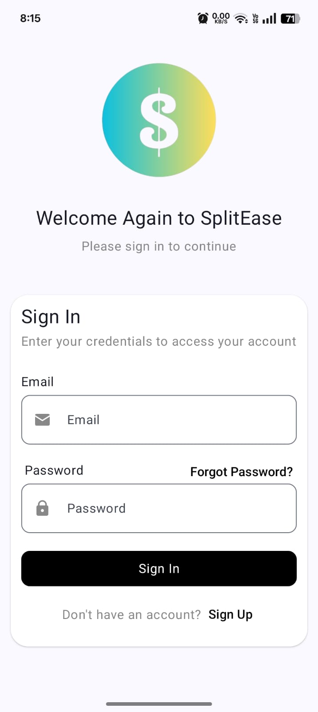
  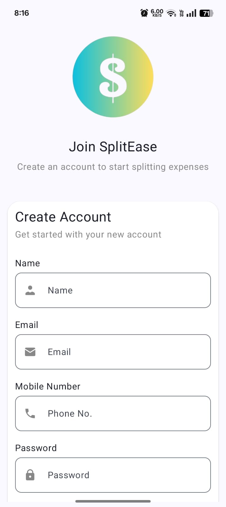
</p>

<p align="center">
  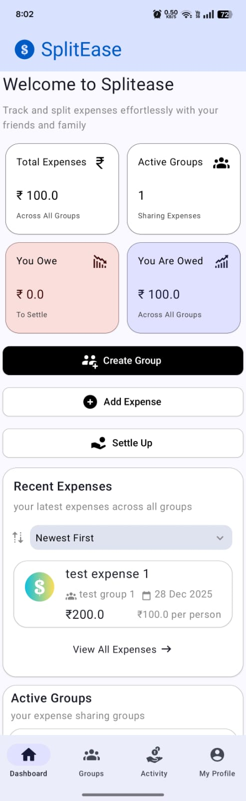
  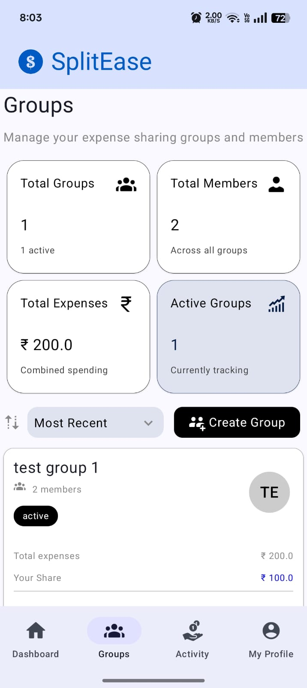
  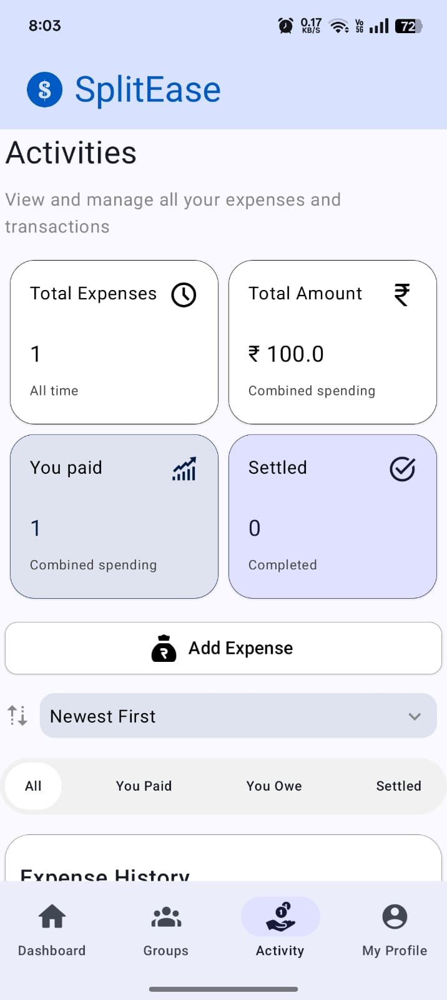
</p>

<p align="center">
   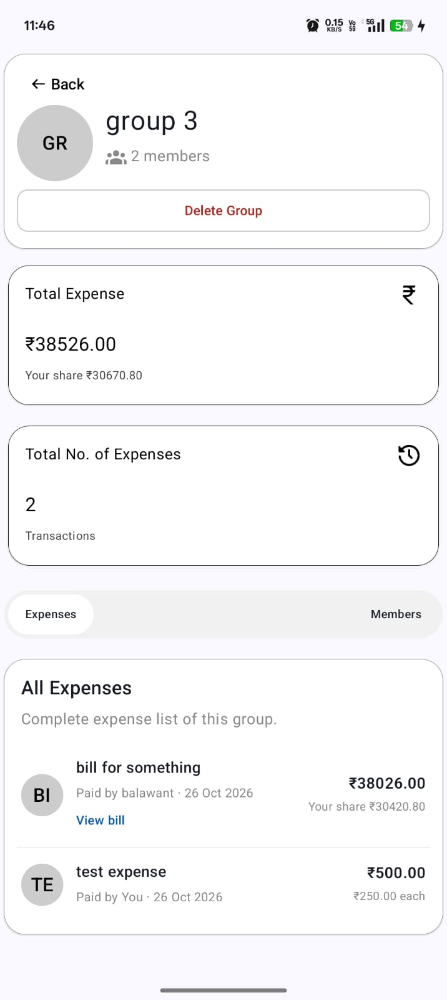
  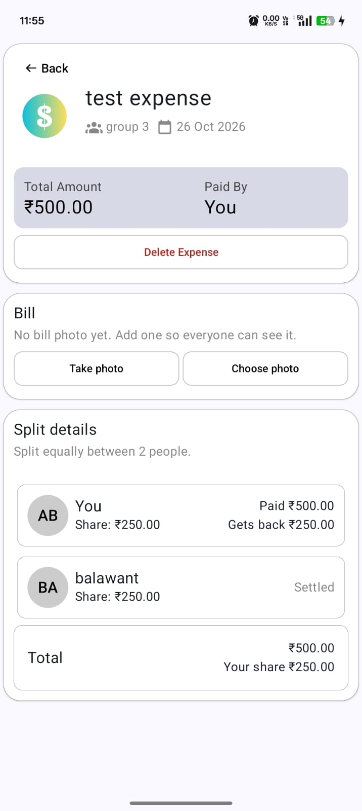
   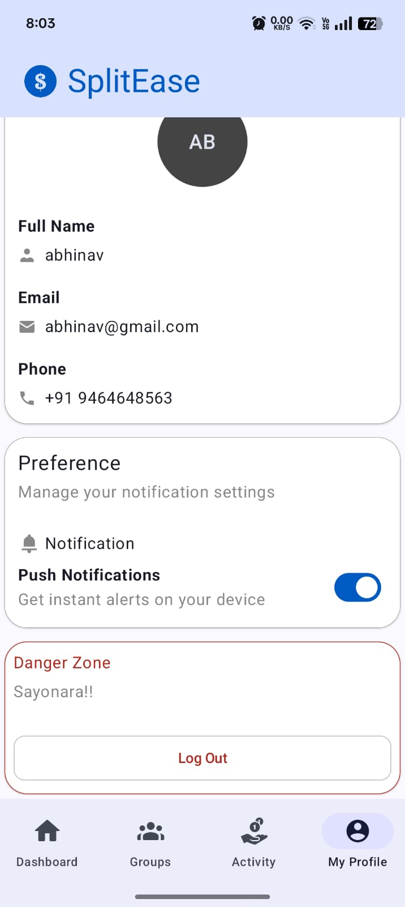
</p>

<p align="center">
  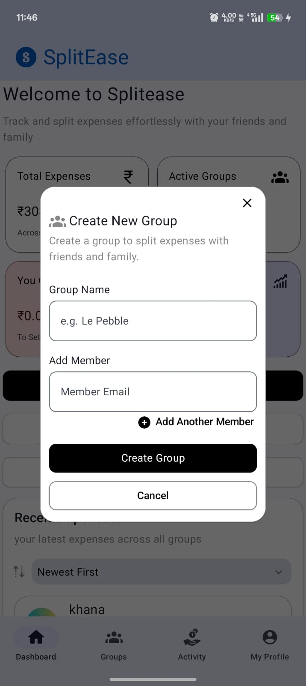
  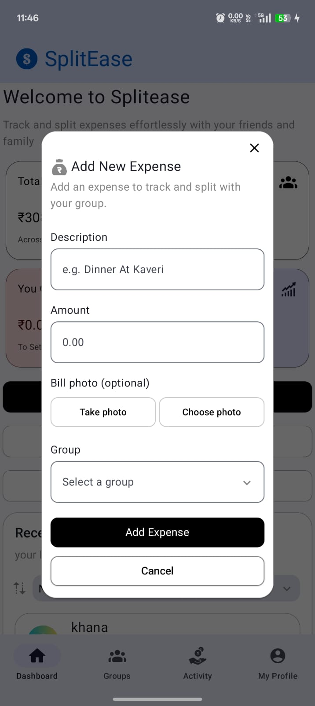
  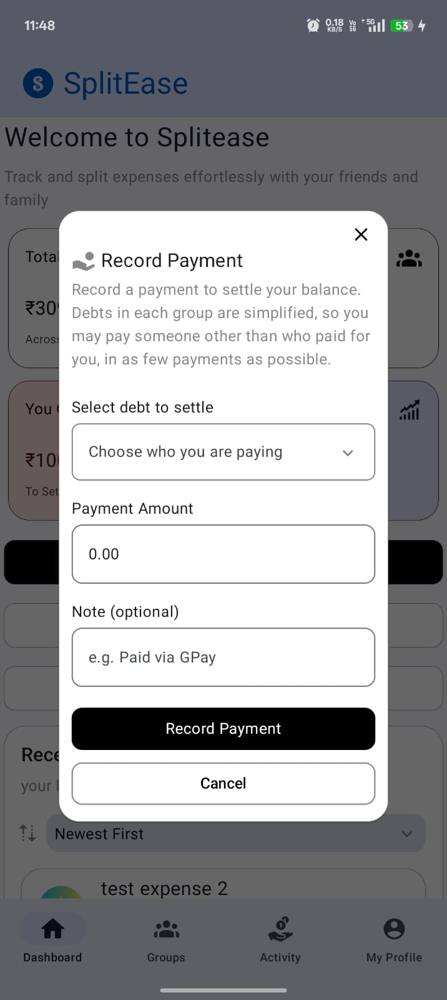
</p>


## Key Features
- **Collaborative Expense Management**: Full-stack system for group expense tracking and ledger management using Spring Boot and PostgreSQL.
- **Flexible Splits**: Split an expense equally between everyone or chosen members, or by exact amounts, percentages or shares. Shares are always rounded so they add up exactly to the expense amount.
- **Bill Photos with On-Device Amount Reading**: Attach a photo of the bill (camera or gallery) when adding an expense, or later from the expense's page. Google ML Kit reads the bill **on the phone, offline**, and a custom parser picks out the total (Grand Total / Net Amount over Subtotal, GST, Cash, Change…) to fill in the amount for the user to confirm. Everyone in the group can view the bill full screen with pinch to zoom; only the payer can attach, replace or remove it.
- **Debt Simplification**: A greedy algorithm settles each group in at most n − 1 payments for n members and cuts out middlemen: if Bob owes Alice and Carol owes Bob, Carol pays Alice directly. What two people owe each other across their shared groups is netted into a single payment, and nobody is asked to pay someone outside their groups.
- **Clear Expense Details**: Every member's share, who paid, and who has settled, with all amounts shown to 2 decimal places.
- **Security Framework**: JWT (JSON Web Tokens) for stateless authentication and BCrypt hashing for passwords. Bill photos are only served to members of the expense's group.
- **Modern Android Architecture**: Reactive UI built with Jetpack Compose following MVVM, with an app-wide data cache so screens don't refetch on every tab switch, plus pull to refresh.
- **Real-time Event Notifications**: Firebase Cloud Messaging (FCM) push notifications for new groups and expenses.
- **Tested**: JUnit suites on both sides: controller, service and repository tests, randomized tests of the debt simplifier and end-to-end flows on the backend, and ViewModel, data cache and bill parser tests on Android.


## Tech Stack

### Frontend
- Android (Kotlin)
- Jetpack Compose (Material 3)
- MVVM Architecture with a manual dependency container (`AppContainer`)
- Retrofit, OkHttp & Moshi
- Coil (image loading)
- Google ML Kit Text Recognition (on-device OCR)
- Firebase Cloud Messaging (FCM)
- JUnit, Robolectric & kotlinx-coroutines-test

### Backend
- Spring Boot 4 (Java 21)
- Spring Security
- JWT Authentication
- PostgreSQL
- JPA / Hibernate
- Firebase Admin SDK (push notifications)
- JUnit 5, Mockito & H2 (tests)

## How Debt Simplification Works
1. Each member's net balance in a group is worked out from the group's open expense splits and the payments recorded in it (positive = owed money, negative = owes money).
2. `DebtSimplifier` repeatedly has the member who owes the most pay the member who is owed the most, as much as one of them needs, until everyone is at zero. Every payment clears at least one person, so a group of n people never needs more than n − 1 payments.
3. Each person's payments across all their groups are then netted per counterpart, so two people always settle with one payment, even if they share several groups.
4. A recorded payment is stored per group. Once everyone in a group is square, its expenses are marked settled.

For example, four friends who each paid for one dinner split four ways, plus one drink bought for a friend, have 13 debts between pairs but need only **one** payment.

## How Bill Reading Works
1. The photo is decoded upright (using its EXIF orientation) at up to 2048 px and compressed to a JPEG of a few hundred KB for upload.
2. ML Kit Text Recognition, whose model is bundled in the app, returns each line of text on the bill with its position.
3. `BillAmountParser` rebuilds the printed rows from those positions (a label and its amount are often separate lines), ranks rows that look like a total, ignores dates, phone numbers, percentages and tax or cash lines, and returns the most likely total.
4. The amount is only a suggestion: it never overwrites an amount the user has typed, and the user always confirms it.

Bill photos are stored in PostgreSQL in their own `expense_receipts` table (with a small server-generated thumbnail), separate from the expense rows so expense lists never load image data.

## Getting Started

### Prerequisites
- Android Studio (latest stable)
- JDK 21 (backend) / JDK 17+ (Android build)
- PostgreSQL
- Gradle (the Gradle and Maven wrappers are included)

### 1. Clone the Repository
```bash
git clone https://github.com/unleashedme/SplitEase.git
cd SplitEase
```

### 2. Backend Setup
- Open `SplitEase-Spring-Backend/` in your IDE
- Create a PostgreSQL database named `splitease`
- Update the database credentials in `src/main/resources/application.properties`. Tables, including `expense_receipts`, are created automatically on startup.
- Set the environment variables:
  - `JWT_SECRET`: a Base64-encoded key of at least 32 bytes, used to sign login tokens
  - `FIREBASE_CREDENTIALS_BASE64`: your Firebase service account JSON, Base64-encoded (for push notifications)
- Run the application (default port: 8080):
  ```bash
  ./mvnw spring-boot:run
  # Without Firebase credentials (push notifications are skipped):
  ./mvnw spring-boot:run -Dspring-boot.run.arguments="--firebase.enabled=false"
  ```
- Run the tests with `./mvnw test`

### 3. Frontend Setup
- Open `SplitEase-Android-Frontend/` in Android Studio and let Gradle sync complete
- Add `google-services.json` to `app/` for Firebase Cloud Messaging
- Set the API base URL (`baseUrl`) in `app/src/main/java/com/example/splitease/data/AppContainer.kt`:
  - deployed backend: its HTTPS URL
  - emulator with a local backend: `http://10.0.2.2:8080/`
  - phone over USB with a local backend: `http://localhost:8080/`, after running `adb reverse tcp:8080 tcp:8080`
- Build and run the app on an emulator or physical device
- Run the tests with `./gradlew :app:testDebugUnitTest`

## API Overview
All endpoints except `/register` and `/login` require an `Authorization: Bearer <token>` header.

| Method | Endpoint | Description |
|---|---|---|
| POST | `/register`, `/login` | Create an account / get a JWT |
| PUT | `/update-token` | Save the device's FCM token |
| GET | `/dashboard` | Totals: spent, owed and owing |
| GET / POST | `/group` | Groups screen data / create a group |
| GET | `/myGroups` | The user's groups and their members |
| DELETE | `/group/{id}` | Delete a group (creator only) |
| POST | `/expense` | Add an expense with an equal or custom split; returns its id |
| DELETE | `/expense/{id}` | Delete an expense (payer only) |
| POST | `/expense/{id}/receipt` | Upload or replace the bill photo (payer only, JPEG/PNG up to 5 MB) |
| GET | `/expense/{id}/receipt?size=thumb\|full` | View the bill photo (group members) |
| DELETE | `/expense/{id}/receipt` | Remove the bill photo (payer only) |
| GET | `/activity` | Expense history with each member's share |
| GET | `/settlements/payables` | Who the user should pay, after simplifying debts |
| POST | `/settlements` | Record a payment (rejected with 409 if balances changed since they were loaded) |

## Project Structure
```bash
SplitEase/
├── SplitEase-Android-Frontend/      # Android app (app/src/main/java/com/example/splitease/)
│   ├── bill/                        # Bill photo scanning (ML Kit) and total parser
│   ├── data/                        # AppContainer, repository, app-wide data cache
│   ├── datastore/                   # Login token storage
│   ├── dto/                         # Request bodies
│   ├── network/                     # Retrofit API, FCM service
│   ├── ui/                          # Jetpack Compose screens, navigation, theme, formatting
│   └── viewmodel/                   # ViewModels (MVVM)
├── SplitEase-Spring-Backend/        # Spring Boot backend (src/main/java/com/example/splitease/)
│   ├── config/                      # Security, JWT filter, Firebase
│   ├── controller/                  # REST controllers
│   ├── service/                     # Business logic (expenses, debt simplification, receipts…)
│   ├── repo/                        # JPA repositories
│   ├── models/                      # Entities
│   └── requestAndResponse/          # Request and response DTOs
├── screenshots/                     # App screenshots
└── README.md
```
